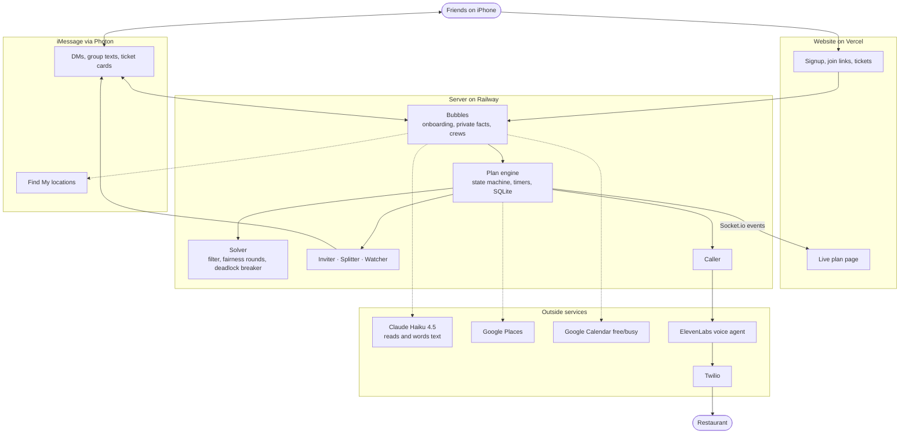

# Bubbleworks

**HackNC 2026** · Photon track "Agents in iMessage"

**Try it:** https://bubbleworks-eosin.vercel.app · watch a recorded plan at
[/p/demo?replay=basic](https://bubbleworks-eosin.vercel.app/p/demo?replay=basic)

## What it does

Bubbleworks gives everyone in a friend group a private AI agent, their **bubble**, that lives in
iMessage. Your bubble knows what you eat, what you're allergic to, what you want to spend, where
you are, and when you're free. You never have to say any of it in the group chat.

Text your bubble "dinner with the boys, feeling indian" and the bubbles plan it:

- They find real restaurants near the crew and keep only the ones that work for **everyone**.
  Allergies, religious diets, and accessibility needs are never bent.
- If nothing fits, one person gets a private nudge ("would $35 work tonight?"). Nobody ever sees
  anyone else's limits.
- A voice agent **calls the restaurant** and books the table, falling back to a backup spot if
  needed.
- Everyone gets a "Booked" ticket in iMessage with Maps and a calendar invite.
- Helper agents take it from there: the **Inviter** sends invites, the **Watcher** asks the
  restaurant to hold the table if someone's running late, and the **Splitter** sends everyone
  their share once the person who paid says how much it was.

A live page shows it as it happens: a Windows Vista style desktop where everyone's bubbles drift
toward the places that fit them, merge into one crew bubble, split into the helpers, and pop as
each job finishes.

## How it works

1. **Sign up** on the website. Your bubble texts you first and asks four quick questions. Claude
   Haiku turns your answers into private facts. Make a crew and share the join link.
2. **Ask for dinner.** Your message reaches your bubble through Photon Spectrum. The plan engine
   pulls live venues from Google Places and reads everyone's calendars and locations.
3. **Decide.** The solver drops any venue that fails anyone's hard limits, scores the rest per
   person, and runs fairness-weighted elimination rounds until one place works for everyone, with
   a backup. If nothing fits, the deadlock breaker finds the smallest stretch and asks just that
   one person, privately.
4. **Book.** The Caller has an ElevenLabs voice agent phone the restaurant through Twilio. The
   result comes back as structured data on a signed webhook, and the group gets its ticket.
5. **Follow through.** The Inviter, Watcher, and Splitter each do their part. Every step is
   streamed to the live page over Socket.io.

Language models never make decisions here. Claude only reads and words text, its output is
validated JSON, and deterministic code picks the venue, decides who gets asked, and books.

**Built with:** TypeScript, Node.js, Fastify, Socket.io, SQLite + Drizzle, zod, Next.js, React,
d3-force, Photon Spectrum, Anthropic Claude, ElevenLabs, Twilio, Google Places, Google Calendar,
OpenStreetMap, Railway, Vercel.

## Team

- **Aditya Karthikeyan**: core and integration. The repo, plan engine, solver and deadlock
  breaker, live venues, Railway, and the iMessage flow after Pranav left.
- **Pranav Somalraju**: messaging. The Photon Spectrum iMessage adapter, plan detection, polls,
  headcount, and the safety layer.
- **Soham Patki**: bubbles and context. Onboarding, private facts, calendar and location signals,
  and the Inviter, Splitter, and Watcher agents.
- **Mahil Manoharan**: voice and web. The ElevenLabs + Twilio caller agent, the Vista Aero
  website and live plan page, and the iMessage link previews.

## License

[MIT](LICENSE)
